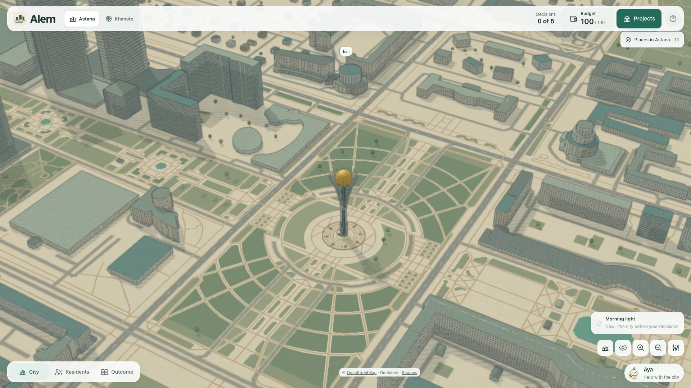
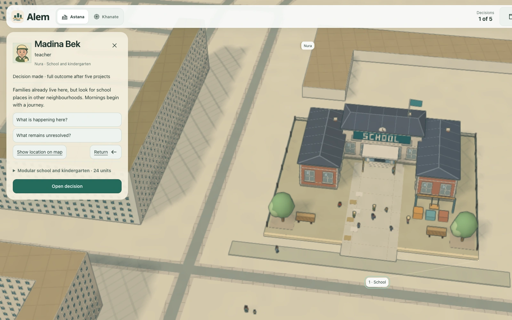
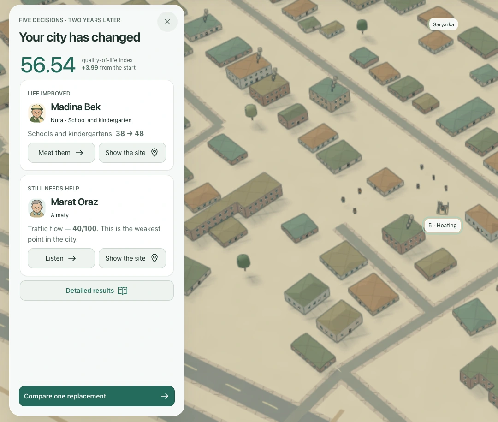
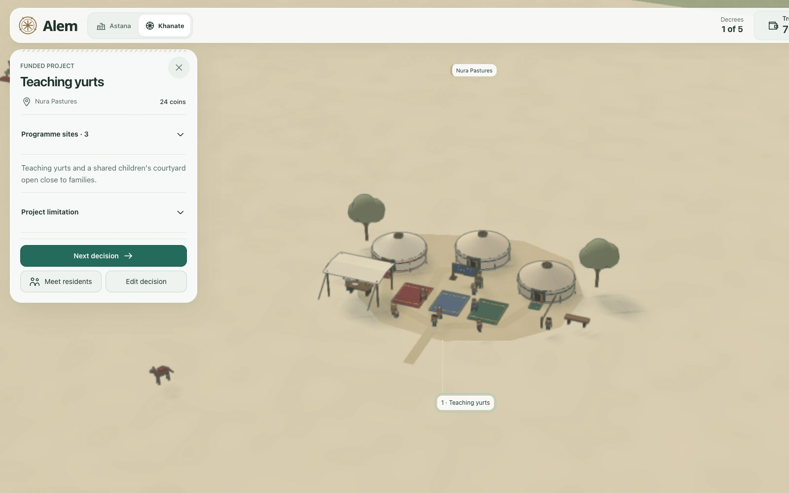

# Alem

A city-management game set in Astana. You have 100 budget units and five decisions. Meet residents, fund projects, and see what changes in the city around them.

**[Play Alem](https://hackalem-alem.up.railway.app/)**

I started Alem at HackAlem AI and continued developing it after the five-hour event. This is my personal, AI-assisted project; the screenshots show the current version.

[](docs/case-study/assets/astana.webp)
*Explore Astana, then choose where its limited budget should go.*

## The brief

The assignment was **“Mayor for 5 Hours”**: build an AI simulator that evaluates five urban-development decisions and explains the resulting quality-of-life score. The district data, fourteen initiatives, costs, conflicts, and eight-quarter calculation were supplied. I kept that model intact and built the game around it.

There is no budget for everything. Each initiative can be used once, no more than two can come from the same policy area, and some projects compete for the same site. The score considers the whole city, its weakest district, and indicators left below a critical threshold.

[Read the complete original assignment](docs/scenario/source/goal-objective.md) · [See how the requirements are implemented](docs/scenario/requirements.md)

HackAlem AI took place in Astana on 23 September 2026. Its **2,415 participants** set the Guinness World Record for [most participants in an agentic AI hackathon](https://www.guinnessworldrecords.com/world-records/778051-most-participants-in-an-agentic-ai-hackathon).

## A decision becomes a place

I wanted the choices to feel connected to people and places. A resident’s story leads to a project; a proposal shows its price and limitation before you commit. Once funded, the project takes shape at its site. You can return to the people it was meant to help.

[](docs/case-study/assets/resident-school.webp)
*Madina’s story concerns school places in Nura; the school and kindergarten cost 24 units.*

The city uses OpenStreetMap geography, with procedural buildings, projects, and people. The residents and their circumstances are authored scenarios. The map gives the decisions a setting; it does not change the supplied calculation.

## See what your choices did

Application code calculates the outcome. AI receives validated results to explain, compare, and discuss. The budget, construction, and explanations all refer to the same plan, so revising a decision also revises its consequences.

[](docs/case-study/assets/outcome.webp)
*The supplied example spends 95 units and scores 56.54 after eight quarters, with gains and unresolved needs shown together.*

These are synthetic scenario results, not predictions for Astana. An [independent calculation audit](docs/scenario/calculation-audit.md) checks the original tables and formula separately from the game’s evaluator.

## The same decisions, another world

Khanate reimagines the setting as a fictional city of the Kazakh steppe. Teaching yurts, caravan routes, and petitions replace their modern counterparts while keeping the same budget, rules, and calculation.

[](docs/case-study/assets/khanate.webp)
*Teaching yurts carry the same educational effect as the modern school project.*

## Run it

Use **Node 24**:

```sh
npm ci --include=dev --ignore-scripts
npm run dev
```

Open **http://localhost:5174**. Core play and local explanations need no API key. Optional live AI dialogue requires server-side configuration.

Built with React, TypeScript, WebGL, and a Node server. Run it locally or explore the calculator, rendering, and optional AI integration.

[Setup and testing](docs/development.md) · [Architecture](docs/architecture.md) · [Agent integration](docs/agents.md)


[Sources and attribution](ATTRIBUTION.md)
